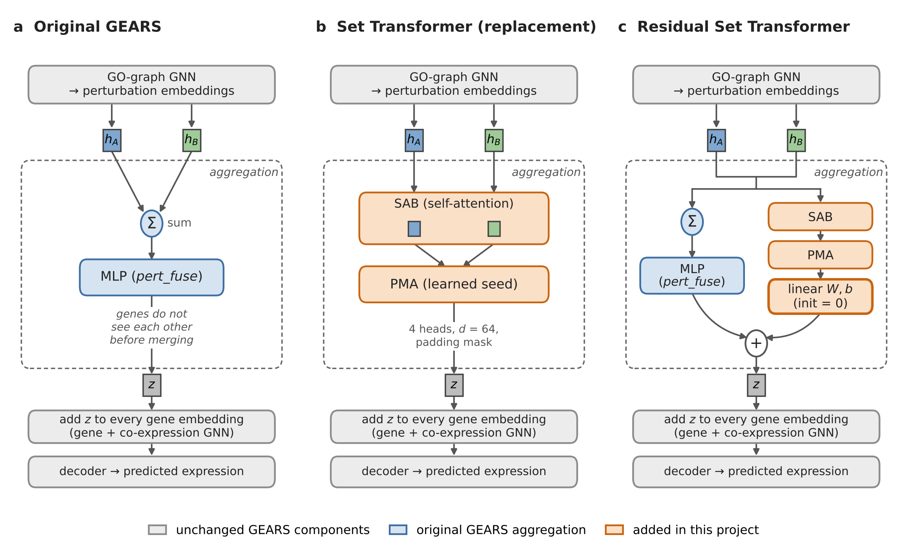

# Extending GEARS with a Set Transformer for Multigene Perturbation Prediction

Course project for ML for Functional Genomics (Barnard/Columbia, Fall 2026) by
Emily Li, Lilian He and Judy Zou. We build on
[GEARS](https://github.com/snap-stanford/GEARS) (Roohani et al., 2024) and ask
whether attention-based aggregation of the perturbed genes improves prediction of
double-gene perturbation responses in the Norman et al. (2019) K562 CRISPRa
Perturb-seq data.

On five matched test splits, the additive baseline remains the best model.
Replacing the GEARS aggregation with a Set Transformer makes DE-gene
predictions worse; adding the Set Transformer as a zero-initialized residual
performs on par with corrected GEARS.

## What we changed in GEARS

Only the step that combines the perturbed genes' embeddings differs; the GO and
co-expression GNNs, decoder and loss are unchanged.

<p align="center"></p>

| Variant | `pert_agg` | Aggregation |
|---|---|---|
| GEARS | `sum` | sum of the GO-updated embeddings, then a two-layer MLP (`pert_fuse`) |
| Set Transformer (replacement) | `set_transformer` | set attention block (SAB) + pooling by multihead attention (PMA), 4 heads, d = 64 |
| Residual Set Transformer | `residual_set_transformer` | `pert_fuse(sum(H)) + W · PMA(SAB(H)) + b`, with W and b initialized to zero |

We also fixed a batching error in the GEARS co-expression GNN: the graph's edges
only indexed the first cell of each batch, so the other cells received only
self-loop updates. With `coexpression_batching="shared"` the graph is convolved
once and the result is copied to every cell. `"legacy"` reproduces the original
behavior. Details and tests: [docs/model-variants.md](docs/model-variants.md).

## Results (Norman, test set, mean ± SD over 5 splits)

Second round: corrected batching, checkpoints selected by validation top-20 DE
MSE. Source: [results/norman/corrected-neural/test_summary](results/norman/corrected-neural/test_summary/report.md).

| Model | MSE ↓ | DE MSE ↓ | Pearson ↑ | DE Pearson ↑ |
|---|---:|---:|---:|---:|
| Additive baseline | **0.00189 ± 0.00047** | **0.0586 ± 0.0119** | **0.9946 ± 0.0012** | **0.9408 ± 0.0500** |
| Linear baseline (Ahlmann-Eltze et al., 2025) | 0.00481 ± 0.00093 | 0.2682 ± 0.0274 | 0.9856 ± 0.0027 | 0.8604 ± 0.0495 |
| GEARS | 0.00511 ± 0.00118 | 0.1146 ± 0.0046 | 0.9872 ± 0.0025 | 0.9140 ± 0.0442 |
| GEARS + Set Transformer | 0.00476 ± 0.00081 | 0.1734 ± 0.0218 | 0.9869 ± 0.0020 | 0.8938 ± 0.0485 |
| GEARS + residual Set Transformer | 0.00496 ± 0.00112 | 0.1195 ± 0.0114 | 0.9875 ± 0.0025 | 0.9118 ± 0.0432 |

DE metrics use each pair's top 20 differentially expressed genes. The first
round (historical batching, selection by validation normalized DE MSE) is
described in [docs/norman-neural-test.md](docs/norman-neural-test.md).

## Repository layout

| Path | Contents |
|---|---|
| `gears/` | GEARS with the three aggregation modes and the batching fix |
| `splits/norman/` | five frozen 76/26/26 pair splits (seeds 1–5) and saved control assignments |
| `configs/` | training protocol (`norman_training.json`), run plan (`norman_runs.csv`) and pinned test configurations |
| `scripts/norman_train.py`, `scripts/run_norman_all.py` | train one run, or all planned runs (skips finished ones) |
| `scripts/norman_additive*`, `scripts/norman_linear*` | additive and fitted linear baselines |
| `scripts/norman_neural_test.py`, `scripts/norman_corrected_neural_test.py` | inference-only test scoring of the first- and second-round checkpoints |
| `results/norman/gears*_train101/` | first-round training runs (historical batching) |
| `results/norman/coexpression_shared_v1/` | second-round GEARS and Set Transformer runs |
| `results/norman/residual_comparison_v1/` | second-round residual Set Transformer runs |
| `results/norman/additive/`, `results/norman/linear/`, `results/norman/corrected-neural/` | baseline outputs and second-round test scores (per split and per pair) |
| `docs/` | protocol notes for splits, baselines, model variants and test evaluations |
| `tests/` | unit and regression tests |

Each training run folder holds `results.json` (validation history and selected
epoch), `model.pt` and `config.pkl`.

## Reproducing

Python 3.10 is recommended so that the pinned versions in `requirements.txt` install.

```bash
conda create -n gears python=3.10 -y && conda activate gears
pip install torch torch_geometric pytest
pip install -e .
python -m pytest tests/test_set_transformer.py tests/test_residual_set_transformer.py tests/test_coexpression_batching.py -q
```

On Windows, clone with `git clone -c core.autocrlf=false …`: the split files are
verified by hash, and line-ending conversion breaks the check.

Train a run or all planned runs (outputs must be outside the checkout; the
Norman data is downloaded automatically):

```bash
python scripts/norman_train.py gears_split1_train101 \
    --data-path /path/to/data --output-root /path/to/runs --device cuda
python scripts/run_norman_all.py --data-path /path/to/data \
    --output-root /path/to/runs --models gears gears_set_transformer gears_residual_set_transformer
```

Training uses only the training and validation pairs. The baselines and test
scoring are documented in [docs/norman-additive.md](docs/norman-additive.md),
[docs/norman-linear.md](docs/norman-linear.md) and
[docs/norman-corrected-neural-test.md](docs/norman-corrected-neural-test.md).

## Branches

`main` holds everything above. The other branches are kept as history:
`set-transformer` and `fix/coexpression-batching` (first and second training
rounds), `feature/residual-set-transformer`, `data-split-norman`,
`additive-baseline-norman`, `linear-baseline-norman`, `norman-neural-test` and
`norman-corrected-residual_transformer-test` (test evaluations).
`feature/additive-residual` implements an additive-baseline-plus-residual variant
that has not been trained.

## Next steps

DepMap-derived gene embeddings (He et al., 2025) and cell-line embeddings for the
Replogle et al. (2022) K562 and RPE1 single-gene screens.

## References

- Roohani, Y., Huang, K. & Leskovec, J. Predicting transcriptional outcomes of novel multigene perturbations with GEARS. *Nat Biotechnol* 42, 927–935 (2024).
- Lee, J. et al. Set Transformer: A Framework for Attention-based Permutation-Invariant Neural Networks. Preprint at https://doi.org/10.48550/arXiv.1810.00825 (2019).
- Norman, T. M. et al. Exploring genetic interaction manifolds constructed from rich single-cell phenotypes. *Science* 365, 786–793 (2019).
- Replogle, J. M. et al. Mapping information-rich genotype-phenotype landscapes with genome-scale Perturb-seq. *Cell* 185, 2559–2575.e28 (2022).
- Ahlmann-Eltze, C., Huber, W. & Anders, S. Deep-learning-based gene perturbation effect prediction does not yet outperform simple linear baselines. *Nat Methods* (2025).
- He, C., Zhang, J., Dahleh, M. & Uhler, C. MORPH Predicts the Single-Cell Outcome of Genetic Perturbations Across Conditions and Data Modalities. Preprint at https://doi.org/10.1101/2025.06.27.661992 (2025).

GEARS is © 2022 Yusuf Roohani, Kexin Huang and Jure Leskovec, released under the
MIT License (see `LICENSE`). Our changes are released under the same license.
